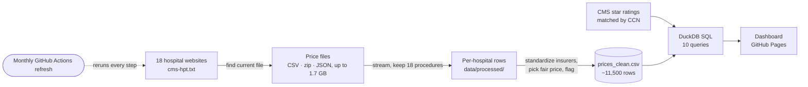

# Boston Hospital Price Explorer

**What will this actually cost me?**

👉 **[See the data story](https://shre0027.github.io/boston-hospital-price-explorer/)** · [Open the dashboard](https://shre0027.github.io/boston-hospital-price-explorer/explore.html) · [Case study](docs/case-study.md) · [SQL analysis](analysis/README.md) · [Decision log](docs/decision-log.md) · [Requirements](docs/requirements.md) · [Data dictionary](docs/data-dictionary.md)

Since 2021, US hospitals have been legally required to publish their prices. But they publish them in huge, messy files that patients can't realistically use. The same MRI can cost very different amounts depending on the hospital and the insurer, and patients usually find out only when the bill arrives.

This project turns those public files into something a normal person can use, and puts each hospital's prices next to its CMS quality rating.

## Key findings
- **Same procedure, very different price:** with commercial insurance, a blood count is $10 at Tufts Medical Center and $90 at MGH (9×); a brain MRI is $338 at South Shore and $1,614 at MGH (5×).
- **Against Medicare:** commercial insurers typically pay 191% of what Medicare pays for the same services (RAND: 195% for Massachusetts), from 113% at BID Milton to 352% at MGH.
- **Two hospitals stand apart:** MGH and Brigham and Women's are about 1.9× the typical price across procedures; Mass General Brigham's own community hospitals are about 1.1×.
- **Price only loosely tracks quality:** 5-star hospitals range from 0.71× to 1.89× the typical price (rank correlation 0.42 across 17 rated hospitals).
- **"Public" isn't always usable:** one system blocks automated downloads, five files break a standard JSON parser, one file lists impossible prices, and one health system lists only 3–6 commercial insurers per hospital.

Full write-up: [case study](docs/case-study.md).

## What it does
1. **Collects** official price files from 18 Greater Boston hospitals, found through each hospital's `cms-hpt.txt`
2. **Cleans** them and keeps 18 common procedures, matched by billing code (CPT or MS-DRG)
3. **Compares** prices across hospitals and insurers, next to CMS star ratings, in a dashboard
4. **Answers plain-English questions** (keyword-based search, answers only from the data), such as "How much is a knee MRI with Blue Cross?"
5. **Checks data quality**: can anyone actually use what each hospital published?

## Hospitals
- **Mass General Brigham:** Massachusetts General · Brigham and Women's · Brigham and Women's Faulkner · Newton-Wellesley · Salem · Mass Eye and Ear
- **Beth Israel Lahey Health:** Beth Israel Deaconess Medical Center · BID Milton · BID Needham · Lahey · Mount Auburn · New England Baptist · Winchester
- **Others:** Boston Medical Center · BMC Brighton · Tufts Medical Center · Cambridge Health Alliance · South Shore

## Status
✅ Live: 18 hospitals, 18 procedures, 11,000+ published prices and CMS quality ratings, presented as a scroll-driven data story plus an interactive dashboard (plain-English search, out-of-pocket estimate). Refreshes automatically every month.

Includes a rough out-of-pocket estimate from your deductible and coinsurance.

Next: MelroseWakefield (Tufts Medicine blocks automated downloads, so it needs a hand download).

## Data source
Hospital machine-readable files published under the CMS Hospital Price Transparency rule (45 CFR Part 180). Quality ratings: CMS Hospital General Information (overall star rating).

*Prices shown are published standard charges, not personal cost estimates.*

## How it works

| Step | Script | What it does |
|---|---|---|
| Find files | `scripts/discover.py` | Reads each hospital's official `cms-hpt.txt` to find its current price file |
| Extract | `scripts/extract_prices.py` | Downloads each file (CSV, zipped CSV or JSON, up to 1.7 GB) and keeps only the selected procedures |
| Combine | `scripts/combine.py` | Standardizes insurer names, numbers and markets; picks a fair comparison price; flags rows that can't be compared |
| Quality | `scripts/fetch_quality.py` | Downloads CMS star ratings, matched to hospitals by CMS Certification Number |
| Medicare benchmark | `scripts/fetch_medicare.py`, `scripts/medicare_rates.py` | Medicare's 2026 rates: outpatient (OPPS Addendum B, wage-adjusted) and lab (CLFS) |
| Map | `scripts/fetch_geo.py` | Geocodes CMS hospital addresses (US Census Geocoder) and downloads town boundaries |
| Analyze (SQL) | `sql/*.sql`, `scripts/run_sql.py` | Twelve documented SQL queries (CTEs, window functions, rank correlation) run with DuckDB; results in [`analysis/`](analysis/README.md) |
| Publish | `scripts/build_site.py` | Fills the page templates in `templates/` with the data to build the scroll-driven story (`site/index.html`) and the dashboard (`site/explore.html`), published with GitHub Pages |

Downloads run on GitHub Actions (`.github/workflows/`), with an automatic monthly refresh (`refresh.yml`) that re-downloads, rebuilds and republishes. Every decision, finding and correction is in the [decision log](docs/decision-log.md).

